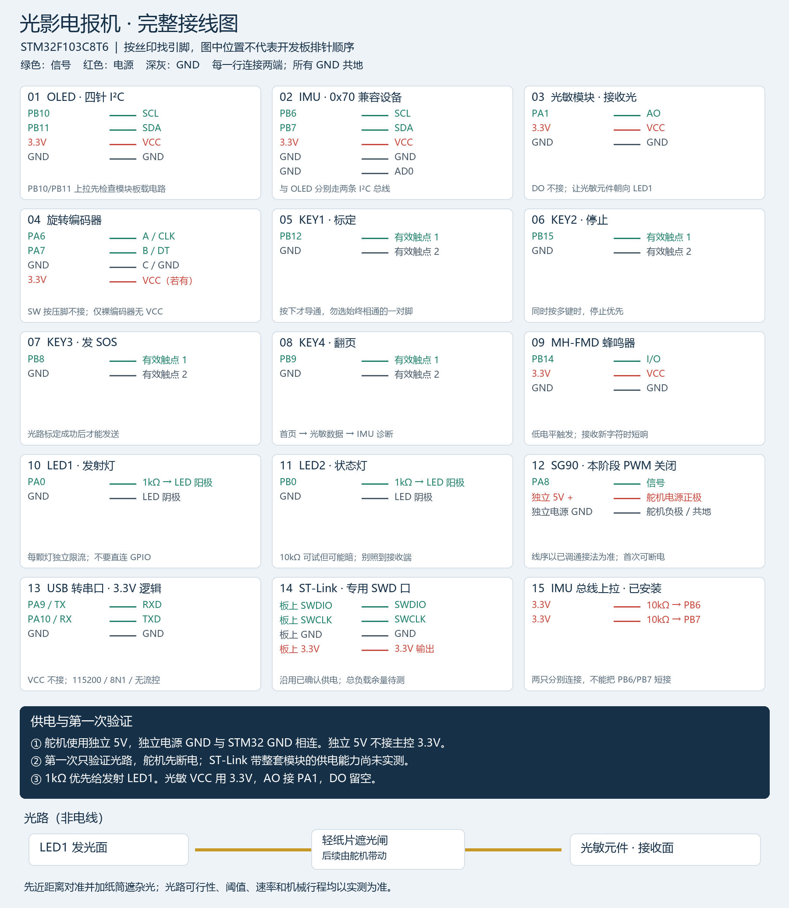
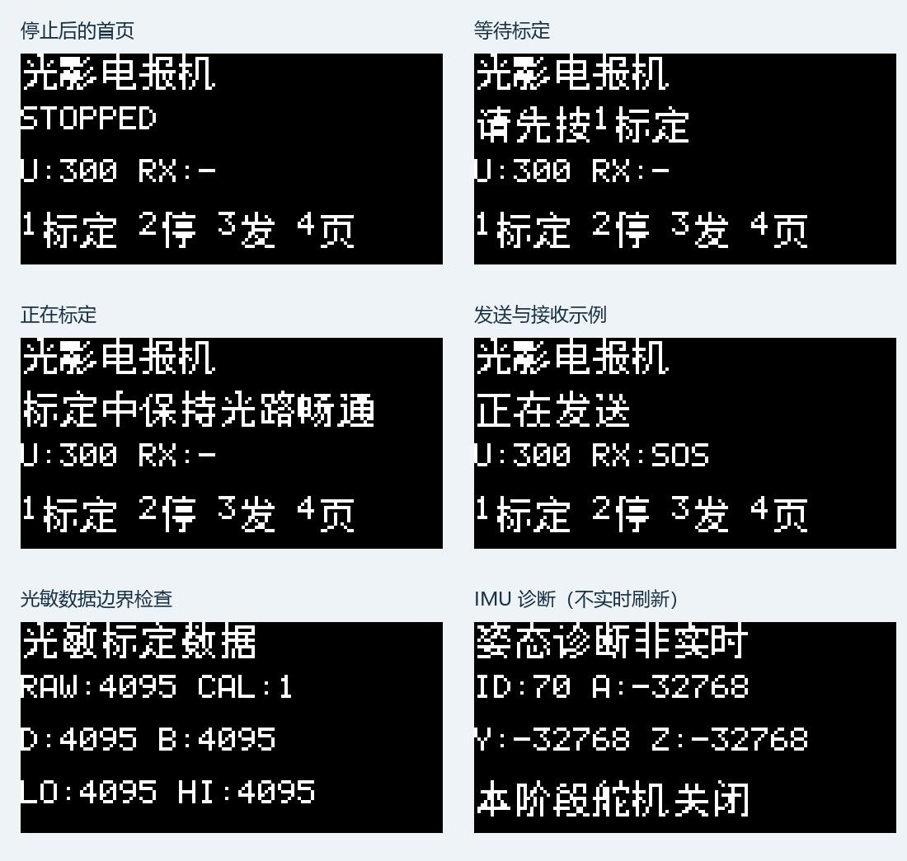

# 光影电报机 · STM32 Light Telegraph

基于 STM32F103C8T6 的近距离光通信互动项目：LED1 发出摩斯码，光敏模块读取真实明暗变化并独立解码，OLED 显示结果。遮住光路后，接收端不会从发送队列直接取得消息。

当前版本为 **V1.0 / 阶段 2**：自动明暗标定与固定 SOS 收发。Keil 实际编译 **0 错误、0 警告**，主机软件测试通过；**尚未完成实体板验收**。

## 快速开始

1. [下载完整工程 ZIP](downloads/LightTelegraph_Stage2_V1.0.zip?raw=true)，完整解压；也可以克隆本仓库。
2. 按[接线说明](docs/01_接线.md)接线。首次测试让 LED1 对准光敏元件，舵机暂不供电。
3. 用 Keil 打开 [firmware/Project.uvprojx](firmware/Project.uvprojx)，目标选择 `Light_Telegraph`，使用 ARM Compiler 5，Rebuild 后通过 ST-Link / SWD 下载。
4. 上电后按 KEY1 标定；显示“就绪”后按 KEY3 发送 SOS。KEY2 停止，KEY4 翻页，旋钮调整码元时长。
5. 查看[烧录与实物验收步骤](docs/03_烧录与验收.md)。串口使用 115200 / 8N1 / 无流控。

公开工程包提供源码、库、HEX 和文档。AXF 调试文件由 Keil 在本机重新生成。HEX 在 [firmware/release/Light_Telegraph.hex](firmware/release/Light_Telegraph.hex)。

## 已实现

- LED1 熄灭/点亮的自动采集，判断 AO 极性并生成迟滞阈值；明暗差异不足则拒绝发送。
- 非阻塞 SOS 发送，短码元为 300～1000ms，旋钮每格调整 50ms。
- 从光敏 AO 独立解码 A～Z、0～9；首版发射内容固定为 SOS。
- 中文 OLED 页面、四键操作、停止优先、状态灯和接收提示音。
- 串口诊断、ADC 超时与调度异常处理。

舵机 PWM 本阶段保持关闭。IMU 保留诊断，标定与标定有效时暂停采样以避免干扰光学时序。完整文字编辑、机械光闸与体感挑战是后续计划，尚未实现。

## 接线图



[查看可放大的 SVG](docs/接线图.svg)。图中按引脚名称连接，模块位置不代表开发板实际排针顺序。

## 环境与硬件

Keil MDK 5.34 / uVision5、ARM Compiler 5.06 update 7 build 960、STM32F10x 标准外设库和 CMSIS；STM32F103C8 配置为 64KB Flash、20KB RAM、HSI/PLL 64MHz。

OLED 位于 PB10/PB11；IMU 位于 PB6/PB7，用户此前测得 WHO_AM_I=0x70，按兼容设备处理，未独立确认芯片型号。光敏 AO 接 PA1，编码器 PA6/PA7，四键 PB12/PB15/PB8/PB9，LED1 PA0、LED2 PB0，蜂鸣器 PB14，舵机信号 PA8，串口 PA9/PA10。

舵机使用独立 5V，并与 STM32 共地；电源正负按已确认线序判断。ST-Link 的整套供电余量、光学距离、响应速度和舵机行程都需实测。

## 串口命令

```text
HELP
STATUS
CAL
SEND SOS
STOP
UNIT 500
LAMP ON
LAMP OFF
```

## 软件验证

在 `firmware` 目录使用 PowerShell：

```powershell
& .\tools\test.ps1
& .\tools\build.ps1
```

脚本的编译器路径可用 `-Gcc`、`-Uv4` 参数调整。源码与配置 XML 保持兼容的无 BOM 编码。

测试覆盖正反 AO 极性、300/1000ms 收发、遮光不产生接收文字、外部脉冲独立解码、ADC 超时、噪声拒绝、计时回绕、输入边界和 OLED 渲染。[查看验证记录](firmware/VALIDATION.md)与 [Keil 日志](firmware/BuildLogs/Keil_Light_Telegraph.log)。



## 目录

| 路径 | 内容 |
|---|---|
| `firmware/` | 唯一维护的 Keil 工程、源码、驱动库与 HEX |
| `docs/` | 接线图、接线表与实物验收步骤 |
| `firmware/tests/` | 主机软件测试 |
| `firmware/tools/` | 编译、测试和页面预览工具 |
| `RELEASE_NOTES.md` | 当前发布内容及验证边界 |

第三方 STM32 库及其原许可文件保留在 `firmware/Library/`。公开仓库不改变第三方库的许可条件。
